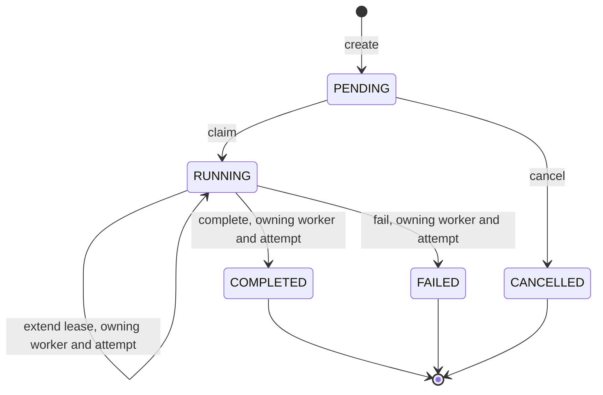

# Durable Workflow Execution Engine

A backend-focused workflow execution engine built to demonstrate
practical software engineering and distributed-systems concepts.

The long-term goal is to build a small but realistic platform that can
execute workflows reliably in the presence of concurrency, failures,
retries, scheduling, and multiple workers.

## Project Goals

This project is intentionally focused on backend engineering rather than
simply building a CRUD application.

The main concepts we will progressively implement are:

-   REST API design
-   relational database design
-   transactions
-   concurrent task claiming
-   worker pools
-   row locking
-   `FOR UPDATE SKIP LOCKED`
-   leases and heartbeats
-   crash recovery
-   fencing
-   retries and exponential backoff
-   idempotency
-   workflow state machines
-   scheduling
-   fairness
-   rate limiting
-   backpressure
-   observability
-   testing concurrent and failure-prone systems
-   containerization and deployment

The project should remain incremental. New infrastructure should only be
introduced when it solves a real problem in the current milestone.

## Technology Stack

### Current

-   Java 25
-   Spring Boot
-   Maven
-   PostgreSQL
-   Spring JDBC / `JdbcClient`
-   Flyway
-   Docker
-   Docker Compose (local PostgreSQL)
-   REST/HTTP
-   JUnit 5
-   Testcontainers (PostgreSQL 16)
-   GitHub Actions (`.github/workflows/ci.yml` runs `./mvnw verify`)

### Planned

-   Redis, if/when justified
-   React + TypeScript frontend
-   Docker Compose for the full stack (application, workers, observability)
-   OpenTelemetry
-   Prometheus/Grafana
-   AWS for the M15 deployment: one EC2 instance running Docker Compose,
    RDS for PostgreSQL, ECR, and SSM Parameter Store, with a measured
    monthly cost

Technologies such as Kafka, Kubernetes, and Terraform are intentionally
deferred until there is a concrete reason to introduce them. The AWS
deployment waits for M15 and stays limited to the services listed above.

## Current Architecture

The current request flow is:

``` text
HTTP Request
    |
    v
TaskController
    |
    v
TaskService
    |
    v
TaskRepository
    |
    v
PostgreSQL
```

### Controller

`TaskController` exposes the HTTP API. Claim, complete, and fail are not
HTTP operations. A worker calls the service for those.

``` text
POST /api/v1/tasks
GET  /api/v1/tasks/{id}
POST /api/v1/tasks/{id}/cancel
```

`POST /api/v1/tasks` creates a task and returns `201` with
`Location: /api/v1/tasks/{id}` and a `TaskResponse`. The body is
`taskType` plus a JSON `payload`. `taskType` must match
`^[A-Z][A-Z0-9_]{0,63}$`. A type that matches and has no handler is still
accepted. The worker fails that task later. JSON null and a NUL byte in
a key or a text value are `400`.

`GET /api/v1/tasks/{id}` returns the task, including `workerId`,
`claimedAt`, `attempt`, and `leaseExpiresAt`, or `404`. A task that has
never been claimed shows `attempt` `0` and `leaseExpiresAt` null. The
response does not include `last_heartbeat_at`.

`POST /api/v1/tasks/{id}/cancel` returns `200` when the task is `PENDING`
or already `CANCELLED`, `409` when it is `RUNNING` or another terminal
status, and `404` when the id is missing.

Errors use RFC 9457 `ProblemDetail` (`application/problem+json`). A
database failure is a generic `500`. The response does not include the
exception text.

``` text
curl -sS -D - -X POST http://localhost:8080/api/v1/tasks \
  -H "Content-Type: application/json" \
  -d "{\"taskType\":\"ECHO\",\"payload\":{\"message\":\"hello\"}}"

curl -sS -D - -X POST http://localhost:8080/api/v1/tasks \
  -H "Content-Type: application/json" \
  -d "{\"taskType\":\"FAIL\",\"payload\":{\"reason\":\"demo\"}}"

curl -sS -D - -X POST http://localhost:8080/api/v1/tasks \
  -H "Content-Type: application/json" \
  -d "{\"taskType\":\"SLEEP\",\"payload\":{\"millis\":500}}"

curl -sS http://localhost:8080/api/v1/tasks/{id}

curl -sS -X POST http://localhost:8080/api/v1/tasks/{id}/cancel
```

With the worker pool running, repeat `GET` until `status` is `COMPLETED`,
`FAILED`, or `CANCELLED`. `ECHO` finishes `COMPLETED` and stores the
payload as `result`. `FAIL` finishes `FAILED` and stores `reason` as
`error` (the error is `failed` when `reason` is absent). `SLEEP` waits
for `millis`, at most 60 seconds, and then finishes `COMPLETED`. Cancel
applies only while the task is still `PENDING`. On Windows, PowerShell's
`curl` is an alias; use `curl.exe`.

### Service

`TaskService` contains application-level logic and owns the transaction
boundary for claiming a task, extending its lease, and for complete,
fail, and cancel.

The important distinction is:

``` text
Controller
    Handles HTTP

Service
    Handles application logic and transactions

Repository
    Handles database access
```

### Repository

`TaskRepository` uses Spring's `JdbcClient` to communicate with
PostgreSQL.

It currently handles:

-   inserting tasks
-   atomically claiming pending tasks, which sets a lease and increments
    `attempt`
-   extending the lease of a running task for its worker and attempt
-   completing or failing a running task for its owning worker and
    attempt
-   cancelling a pending task

## Task Model

Tasks currently have the following fields:

``` text
id          uuid
task_type   text, format-checked (for example NOOP)
status      TaskStatus in Java, text in the database
payload     jsonb, read back as text
result      jsonb, null until a task completes
error       text, null until a task fails
created_at  timestamptz
updated_at  timestamptz, set again on every write
claimed_at  timestamptz, null while the task is pending
finished_at timestamptz, set only when the task is terminal
worker_id   uuid, null while the task is pending
attempt     int, 0 until the first claim; only claim increments it
lease_expires_at  timestamptz, set by claim, moved by heartbeats
last_heartbeat_at timestamptz, null until the first heartbeat of a claim
```

`TaskStatus` is `PENDING`, `RUNNING`, `COMPLETED`, `FAILED`, or
`CANCELLED`. `isTerminal()` is true for the last three. The enum does
not decide which transition is legal. Each write is one `UPDATE`, and
its `WHERE` clause is the rule:

``` text
claim    PENDING  -> RUNNING     for one worker, attempt + 1, new lease
extend   RUNNING  -> RUNNING     only that worker and attempt
complete RUNNING -> COMPLETED    only that worker and attempt
fail     RUNNING -> FAILED       only that worker and attempt
cancel   PENDING -> CANCELLED
```



A task begins as `PENDING`. Claim moves it to `RUNNING` and records the
worker. Complete and fail then set `finished_at` and `updated_at`. Cancel
does the same, and only while the task is still pending. If the `UPDATE`
changes zero rows, the service reads the row once to name the outcome
(already applied, already cancelled, or rejected). That read does not
write again. Complete and fail are not HTTP operations. Cancel is
`POST /api/v1/tasks/{id}/cancel`.

Calling complete again with a different result does not overwrite the
first result. The second call is "already applied" when the same worker
and the same attempt already reached that status. A different attempt
is rejected, even from the same worker. Complete and fail do not
require the lease to be unexpired.

There is no engine path from `RUNNING` back to `PENDING`. An operator can
requeue by hand, and only by pinning the worker they observed. That
statement is not an API. It is safe for the engine's row. The handler may
already have run, and it may run again:

``` sql
UPDATE tasks
SET status = 'PENDING', worker_id = NULL, claimed_at = NULL,
    updated_at = now()
WHERE id = :id
  AND status = 'RUNNING'
  AND worker_id = :observedWorkerId;
```

That statement leaves `attempt`, `lease_expires_at`, and
`last_heartbeat_at` on the `PENDING` row. The next claim increments
`attempt`, replaces the lease, and clears the heartbeat, so the old
attempt's writes are rejected.

`TaskExecutor.runOnce` is one claim, one handler call, and one finish
write. `WorkerPool` calls it from a fixed number of platform threads
(`engine.worker.concurrency`, default 4) when `engine.worker.enabled`
is true. Each loop has its own worker id for as long as it lives, and
the thread is named `host-pid-loopN`. An empty queue waits, then
tries again. A loop does not pick up a second task while one is still
running.

The idle wait starts at `poll-interval` and doubles on each consecutive
empty claim, up to `max-idle-interval`. Equal jitter picks a duration
from half of that delay through the whole delay, so loops that found
nothing together do not wake on the same tick, and the wait cannot
collapse into a spin. A claim clears the miss count, so the next idle
wait is short again. Shutdown opens the latch and ends the wait.
`error-backoff` stays a fixed wait after a database or transaction
error. A task created while every loop is already at the cap is claimed
within `max-idle-interval`.

`engine.worker` settings, with the defaults from `application.yaml`:

-   `enabled` (`true`): start the pool with the application. Tests set
    this to `false` and build their own pool.
-   `concurrency` (`4`): platform-thread loops. In-flight handlers never
    exceed this number. Each loop pulls one task at a time and does not
    prefetch.
-   `poll-interval` (`1s`): the base idle delay. The first empty claim
    waits between half of this and the full value.
-   `max-idle-interval` (`30s`): the cap for that delay. It must be at
    least `poll-interval`.
-   `error-backoff` (`1s`): fixed wait after a database or transaction
    error, then the loop continues.
-   `shutdown-timeout` (`20s`): how long shutdown waits for work already
    claimed before interrupting it. This must be shorter than
    `spring.lifecycle.timeout-per-shutdown-phase` (30 seconds unless
    changed). It is not a limit on how long a handler may run while the
    process is up.

On shutdown the pool stops claiming, then waits `shutdown-timeout`. A
task already claimed is still executed. If a handler is still going when
the wait ends, it is interrupted and left `RUNNING` when it honors the
interrupt.

`/actuator/health` includes a `workerPool` component.
`application.yaml` sets `show-components` and `show-details` to
`always`, and the endpoint is unauthenticated. The component is `UP`
when workers are disabled. It is `UP` when the pool is running, no
loop has exited unexpectedly, and `liveLoops` equals `concurrency`.
That match means every configured loop is inside `run`, including a
loop waiting on an empty queue or backing off after a database error.
It is worker-loop readiness only. It does not mean a handler is making
progress, that the database is reachable, or that tasks are being
processed.

It is `OUT_OF_SERVICE` when workers are enabled and the pool is
stopped or stopping, including a normal shutdown. It is also
`OUT_OF_SERVICE` when the pool is running and `liveLoops` is still
below `concurrency` with no unexpected exit. `start` reports running
after the loops are submitted, and each loop increments `liveLoops`
when it enters `run`. A loop that dies decrements `liveLoops` before
it increments `unexpectedExits`, so one sample can report
`OUT_OF_SERVICE` and the next `DOWN`.

It is `DOWN` when a loop leaves `run` while the pool is still started
and not stopping. The other loops keep pulling. Nothing starts a
replacement. Details include `enabled`, `running`, `stopping`,
`concurrency`, `liveLoops`, and `unexpectedExits`.

Hikari `maximum-pool-size` (default 10) must be at least
`engine.worker.concurrency` plus headroom for API requests plus one for
the lease-heartbeat thread. A handler does not hold a connection, so the
pool is not sized as one connection per running handler. Nothing checks
that size at startup.

A caller of `runOnce` does three things:

1.  Claim one pending task, in a transaction. That sets the lease and
    the attempt.
2.  Run the handler for that `task_type` with no transaction and no
    database connection. Heartbeats extend the lease meanwhile, on their
    own thread and connection.
3.  Write the outcome once: complete, or fail, with the claimed attempt.
    If that write throws, the task stays `RUNNING`. There is no second
    attempt.

Handlers are always registered: `NOOP` completes and stores JSON null,
`ECHO` stores the payload as the result, `FAIL` fails (a textual
`reason` field in the payload is the error, otherwise the error is
`failed`), and `SLEEP` sleeps for the payload's `millis` (at most 60
seconds) and then completes. An unknown type, a thrown exception, or a
null return is one fail write. An interrupt while the handler is still
running leaves the task `RUNNING` with the same worker. If the handler
already returned, that outcome is still written once. Startup fails if
two handlers use the same type, or if a type does not match the
`task_type` check.

The HTTP API is the controller section above. Further states may be
introduced later if they are justified by the workflow requirements.

### Leases and heartbeats

A claim is a lease. The claim statement sets `lease_expires_at` to the
database's `NOW()` plus `engine.lease.duration`, written as
`NOW() + (:leaseMicros * INTERVAL '1 microsecond')` so a sub-second
duration does not round to zero. The same statement increments
`attempt` and clears `last_heartbeat_at`. Nothing else increments
`attempt`.

While a handler runs, `LeaseHeartbeat` extends that lease from one
shared scheduler thread. Each in-flight task gets one fixed-delay tick
every `engine.lease.heartbeat-interval`, starting one interval after the
handler starts. A tick is one guarded update (`id`, `RUNNING`,
`worker_id`, `attempt`) that moves `lease_expires_at` and sets
`last_heartbeat_at`. A lease already in the past still extends when the
guard matches.

-   If the update matches nothing while the task is still running,
    `TaskContext.leaseLost()` becomes `true` and that task's ticks stop.
    This is a request to stop. Nothing interrupts the handler, and it
    may ignore the flag. The built-in handlers do not check it. If the
    handler returns an outcome, that outcome still gets its one finish
    write, and the attempt guard rejects it if the attempt changed.
-   A tick that throws an exception, such as a data-access error, is
    logged and is not lease loss. The next tick tries again.
-   The executor closes the task's watch on every exit from the handler,
    before the finish write. A tick that runs after that does nothing,
    so a finished task's late tick does not flag lease loss.

`engine.lease` settings, with the defaults from `application.yaml`:

-   `duration` (`30s`): how long a claim or a heartbeat makes the lease.
-   `heartbeat-interval` (`10s`): the delay between ticks for one task.

Startup fails if either value is under one microsecond, or if the
interval is not shorter than the duration. Heartbeat every lease/3 is a
starting heuristic, not a proved constant. An interval longer than a
third of the lease still starts. A shorter lease would let an M4 reaper
notice a dead worker sooner, and would also make a false expiry more
likely. Nothing acts on an expiry yet.

A lease that expires is only a timestamp. Nothing in M3 reads it.
Nothing requeues the row, and the worker that holds it can still extend,
complete, or fail it. Cancel of a `RUNNING` task is still `409`.

## Guarantees

These are the M1 guarantees. They match ADR 0004 and the tests named
under "How this is tested". They are not a promise of exactly-once or
at-least-once delivery.

1.  **This process** claims a given `PENDING` row at most once and never
    puts it back to `PENDING`. A crash after claim and before the handler
    runs leaves the row `RUNNING` with zero handler calls.
2.  At most one **applied** `COMPLETED` or `FAILED` write per claim, and
    only from the claiming loop (`WHERE id AND status = 'RUNNING' AND
    worker_id`). Terminal states stay terminal because of that `WHERE`,
    not because a `CHECK` can see the previous status. Cancel applies
    only to `PENDING`.
3.  Named V4 checks: `finished_at` is set exactly when the status is
    terminal; `RUNNING` has an owner; `PENDING` has none; `task_type`
    matches `^[A-Z][A-Z0-9_]{0,63}$`.
4.  No transaction and no pooled connection is held while a handler runs.
5.  In-flight handlers never exceed `engine.worker.concurrency`. Pull is
    one task at a time, with no prefetch.
6.  After stop: no new claims; a claimed task is always executed; a
    **returned** outcome gets one finish attempt; a handler still running
    at the deadline is interrupted and left `RUNNING` if it honors the
    interrupt.
7.  `RUNNING` means **claimed and not finished**. The database cannot
    tell a live handler from a crash, an interrupt, or a finish write
    that threw.
8.  The manual requeue above is safe for **engine state** when it pins
    the worker that was observed. The handler may already have run, and
    it may run again.

M3 adds these. They match ADR 0003 and ADR 0004:

1.  One claim statement sets `lease_expires_at` from `NOW()` plus the
    configured duration, increments `attempt` by one, and clears
    `last_heartbeat_at`. No other production statement increments
    `attempt`.
2.  Lease extension, complete, and fail apply only when `id`,
    `RUNNING`, `worker_id`, and `attempt` all match. A mismatch writes
    nothing. The same worker with a different attempt is rejected while
    the row is still `RUNNING`.
3.  Complete and fail do not require an unexpired lease, do not clear
    the lease columns, and are not written again after zero rows or a
    thrown database error.
4.  A handler that keeps getting successful heartbeats stays `RUNNING`
    past the original lease, and `lease_expires_at` moves forward.
5.  `RUNNING` requires `worker_id`, `claimed_at`, and
    `lease_expires_at` (one replaced `tasks_running_has_owner_check`).
6.  The heartbeat watch stops on every exit from the handler, including
    an interrupt and an `Error`, before the finish write.

Neither M1 nor M3 provides, and this document does not claim:

-   exactly-once execution
-   at-least-once execution (that is ADR 0002, after recovery in M4)
-   automatic recovery or a reaper. An expired lease stays on a
    `RUNNING` row
-   that an expired lease means another worker owns the task
-   that a handler stops when `leaseLost()` becomes `true`. The built-in
    handlers do not check it
-   that a garbage-collection pause or a stalled heartbeat thread is
    detected as lease loss
-   that a returned outcome always commits (`RUNNING` after a failed
    finish write is allowed)
-   the zombie proof: a worker that resumes after **another** worker
    claimed the task through recovery. The `attempt` guard exists (ADR
    0003), and tests exercise it with a test-only requeue. A later claim
    happens in production only after M4 recovery
-   handler timeouts or detection of a hung worker
-   task-level retries

"The handler ran at most once" describes this process's control flow.
It is not a durability guarantee. A manual requeue, and a future reaper,
are second invocations.

## Known limitations

-   **Stuck `RUNNING`.** A crash after claim, an interrupt during the
    handler, or a finish write that throws leaves the task `RUNNING`.
    Its lease expires, and nothing acts on that. The pool does not claim
    that row again.
-   **An expired lease is not lost ownership.** A handler that never
    heartbeats, or that ignores `leaseLost()`, can leave an expired
    lease on a `RUNNING` row. Its worker can still extend, complete, or
    fail it. Nothing requeues it until M4.
-   **One heartbeat thread.** Every in-flight task's tick runs on the
    same thread. One slow JDBC call delays every other task's tick. That
    is not lease loss, and a long enough delay lets other leases expire.
-   **Pauses.** A garbage-collection pause can let a lease expire while
    the handler is alive. Nothing signals that to the handler.
-   **Shutdown.** Heartbeats continue while shutdown waits for in-flight
    handlers, then the heartbeat scheduler stops. A handler that ignores
    the interrupt can keep running with a lease that no longer moves.
-   **Legacy `RUNNING` rows.** `POST /tasks/claim` used to claim a task
    and leave it `RUNNING`, because nothing finished it. Those rows stay
    `RUNNING`. V4 does not repair them. A `RUNNING` row with no owner
    fails the V4 migration instead.
-   **Legacy `PENDING` rows.** Rows that existed before V4 were stored as
    `task_type = 'NOOP'`. A worker completes them as no-ops (JSON null
    result).
-   **`kill -9` versus a host crash.** `kill -9` after the claim
    transaction has committed leaves the task `RUNNING`. `kill -9` during
    that transaction rolls the claim back, so the row stays `PENDING`,
    because the kernel closes the database socket. A host crash or a
    network partition can hold the row lock until TCP keepalive ends.
    Production does not set `idle_in_transaction_session_timeout`.
-   **Manual requeue.** The owner-pinned `UPDATE` above is safe for the
    row. It is not safe for side effects: the handler may run twice.
-   **`RUNNING` is not "currently executing".** It means the row was
    claimed and has not finished. The handler may be running, may have
    crashed, may have been interrupted, or may have returned an outcome
    whose finish write did not commit.
-   **A dead loop stays dead.** An `Error` from a loop is logged and
    that thread ends. The pool's lifecycle flag stays running, and
    `/actuator/health` reports `workerPool` as `DOWN`. The remaining
    loops keep pulling. Nothing starts a replacement thread. Restart
    the process to get the configured concurrency back.

## Database

PostgreSQL runs locally through Docker Compose (`docker-compose.yml`:
image `postgres:16-alpine`, database `durable_workflow`, port 5432, data
kept in the named volume `pgdata`).

Flyway migrations in `src/main/resources/db/migration` build the schema:

-   `V1` creates the `tasks` table and enables PostgreSQL's `pgcrypto`
    extension for UUID generation.
-   `V2` fixes the default on `claimed_at`.
-   `V3` converts `created_at` and `claimed_at` to `timestamptz`, adds
    `updated_at`, adds the `CHECK` constraint on `status`, and adds the
    partial index `idx_tasks_pending` on `created_at` for pending rows.
-   `V4` adds `task_type`, `result`, `error`, and `finished_at`. Existing
    rows become `task_type = 'NOOP'`, then that default is dropped. Pending
    rows that still have `claimed_at` or `worker_id` (possible after V1)
    have those cleared. Terminal rows get `finished_at`. Named checks then
    require: `task_type` matches `^[A-Z][A-Z0-9_]{0,63}$`; `finished_at` is
    set exactly when the status is terminal; `RUNNING` has an owner;
    `PENDING` has none. A `RUNNING` row with no owner is not repaired, so
    the migration fails. If a local Compose database was edited into that
    shape, `docker compose down -v` drops it. A `NOOP` row completes with
    a JSON null result when a worker claims it. With
    `engine.worker.enabled=true` (the default), the pool does that while
    the application is running. Tests set the flag to false so they can
    claim rows themselves.
-   `V5` adds `lease_expires_at`, `attempt` (default `0`), and
    `last_heartbeat_at`. Existing `RUNNING` rows get
    `lease_expires_at = claimed_at`, so their lease is already expired,
    and they stay `RUNNING` with `attempt` `0`. It then replaces
    `tasks_running_has_owner_check` with one check of the same name:
    `RUNNING` requires `worker_id`, `claimed_at`, and `lease_expires_at`.
    It adds the partial index `idx_tasks_running_lease` on
    `lease_expires_at` for running rows. No query uses that index yet;
    it is for the M4 reaper. Apply V5 with the application stopped.
    Running workers from before V5 do not set a lease on claim, so the
    new check would reject their claims.

The datasource is read from `DB_URL`, `DB_USERNAME`, and `DB_PASSWORD`.
The defaults match the Compose database, so the application runs without
setting them. Integration tests do not use these settings; they start a
temporary PostgreSQL container through Testcontainers.

The database is intentionally the source of truth for task state.

### Running locally

``` text
docker compose up -d
./mvnw spring-boot:run
./mvnw verify
```

Use `.\mvnw.cmd` on Windows. `verify` needs Docker running (for
Testcontainers) but does not need the Compose database.

`spring-boot:run` starts the worker pool. `POST /api/v1/tasks` with
`taskType` `ECHO`, `FAIL`, `SLEEP`, or `NOOP` is claimed by that pool.
A database error backs off (`engine.worker.error-backoff`) and the loop
keeps running. A crash after claim leaves the task `RUNNING` with a
lease that expires; the pool does not pick that row up again.

### Demo

With Compose and the application running, create a task and read it
until the status is terminal. `ECHO` finishes `COMPLETED`:

``` text
curl -sS -D - -X POST http://localhost:8080/api/v1/tasks \
  -H "Content-Type: application/json" \
  -d "{\"taskType\":\"ECHO\",\"payload\":{\"message\":\"hello\"}}"

curl -sS http://localhost:8080/api/v1/tasks/{id}
```

Repeat `GET` until `status` is `COMPLETED`. The same create with `FAIL`
and `"reason":"demo"` finishes `FAILED`, and `error` is `demo`. The same
create with `SLEEP` and `"millis":500` finishes `COMPLETED` after the
sleep. A task that is still `PENDING` can be cancelled with
`POST /api/v1/tasks/{id}/cancel`.

## Concurrent Task Claiming

The first major distributed-systems problem implemented by the project
is safe concurrent task claiming.

A naive implementation could allow two workers to observe the same
`PENDING` task before either updates it.

The project instead uses PostgreSQL row locking:

``` sql
SELECT id
FROM tasks
WHERE status = 'PENDING'
ORDER BY created_at
LIMIT 1
FOR UPDATE SKIP LOCKED
```

The claim operation then changes the selected task to:

``` text
status            = RUNNING
claimed_at        = current timestamp
updated_at        = current timestamp (same now() as claimed_at)
worker_id         = claiming worker
lease_expires_at  = now() + engine.lease.duration
attempt           = attempt + 1
last_heartbeat_at = NULL
```

The update also requires the row to still be `PENDING`. A null
`workerId` is rejected in Java before that write.

The repository uses PostgreSQL's `RETURNING` capability to return the
updated task.

The service method is transactional so that the database operation is
executed within a transaction boundary.

### Why `SKIP LOCKED`?

If Worker A has locked a pending task, Worker B should not wait for
Worker A to finish before looking for work.

Instead:

``` text
Worker A                    Worker B

lock Task 1
                            Task 1 is locked
                            skip Task 1
                            claim Task 2
```

This allows multiple workers to make progress concurrently.

### How this is tested

-   `ConcurrentTaskClaimTest` has many threads claim from a set of
    pending tasks at once and asserts that no task is claimed twice and
    every task is claimed. A claim that waited on a lock would also pass
    this test, so on its own it does not prove `SKIP LOCKED`.
-   `SkipLockedClaimTest` holds a row lock on the oldest pending task in
    a separate, uncommitted JDBC transaction and asserts that
    `claimTask` returns the next task (or `null` if every pending task is
    locked) instead of waiting. Removing `SKIP LOCKED` makes it fail
    because of a short `statement_timeout`.
-   `DurableWorkflowEngineApplicationTests` checks that the application
    context starts and the migrations apply to a fresh database.
-   `V4MigrationTest` migrates a second database only as far as V3, inserts
    a pending row that still has `claimed_at`, a running row with an owner,
    and a completed row with no `finished_at`, then migrates to V4 (and
    stops there) and checks the backfill and the constraint names.
-   `V5MigrationTest` migrates its own database to V4, inserts a pending
    row, a running row with an owner and a past `claimed_at`, and a
    completed row, then migrates to V5. Every row has `attempt` `0`. The
    running row's lease equals its `claimed_at`, and no row has a
    heartbeat. The check names are unchanged, the one
    `tasks_running_has_owner_check` names `worker_id`, `claimed_at`, and
    `lease_expires_at`, `idx_tasks_running_lease` exists, and a
    `RUNNING` insert with no lease fails with SQLState `23514`.
-   `ClaimUpdatedAtTest` backdates `updated_at`, claims the task, and
    checks that `updated_at` moved to the same instant as `claimed_at`.
    Two claimed tasks each go from `attempt` `0` to `1`, have no
    heartbeat, and have `lease_expires_at = claimed_at + duration` in
    SQL. It also checks that a null worker id is rejected and the row
    stays `PENDING`.
-   `LeasePropertiesTest` checks the 30s and 10s defaults, rejects null,
    zero, negative, and sub-microsecond values and an interval that is
    not shorter than the duration, accepts an interval longer than a
    third of the lease, and truncates `leaseMicros` to whole
    microseconds.
-   `GuardedTransitionTest` tries complete, fail, and cancel from every
    status. An applied write moves `updated_at` and `finished_at`. A
    rejected write leaves the row unchanged. A second complete with a
    different result is already applied. The documented requeue, pinned
    to the observed worker, lets a new worker finish with its own
    attempt and rejects the old one.
-   `LeaseExtensionTest` extends a lease and checks
    `lease_expires_at = last_heartbeat_at + duration`, including a
    sub-second duration, with `updated_at` and `attempt` unchanged. A
    wrong id, worker, or attempt, a `PENDING` row, and a terminal row
    return `false` and change nothing. A lease already in the past still
    extends. The same worker with another attempt cannot extend,
    complete, or fail a row that is still `RUNNING`, and after a real
    complete or fail that call is rejected, not already applied. Test
    SQL requeues a task and the same worker claims it again: the attempt
    goes up, the old attempt is rejected, and the new one completes.
    Only claim changes `attempt`.
-   `TransitionLockHoldTest` holds an uncommitted claim. Cancel waits
    (`pg_blocking_pids`), then is rejected if that claim commits and
    applies if it rolls back. A second claim returns nothing while the
    first claim is still open, and the committed worker is still the
    first one.
-   `TaskExecutorTest` calls `runOnce` directly. Echo completes with the
    payload as the result, a failed outcome and a thrown exception and
    an unknown type each fail once, an empty queue returns false, the
    handler runs with no transaction and no borrowed connection, an
    interrupt during `SLEEP` leaves the task `RUNNING`, and a returned
    outcome is still written once if the thread is interrupted afterward.
-   `LeaseHeartbeatTest` runs the heartbeat and the executor on a
    scheduler that fires only when the test says so, with no database.
    The first delay and the period are the interval, and nothing runs
    until a fire. One fire is one extend for that worker and attempt.
    `false` sets `leaseLost()` and cancels the tick. A data-access error
    or another exception is not lease loss, and the next fire extends
    again. An `Error` propagates. A watch closed before or during the
    extend does not set `leaseLost()`. An interrupt, an `Error`, or an
    exception from the handler cancels the tick before any finish. A
    returned outcome is finished once even after lease loss. A missing
    handler starts no tick. A stopped heartbeat hands out a closed watch,
    and its phase is below `WorkerPool`'s.
-   `LeaseHeartbeatIntegrationTest` uses its own context with a 1s lease
    and a 300ms heartbeat. A blocked handler stays `RUNNING` for three
    lease durations, measured with `clock_timestamp()`, while the lease
    moves forward, then completes once. With a real `LeaseHeartbeat` on a
    scheduler that never fires, the lease expires and the task is still
    `RUNNING` with the same worker. When test SQL bumps `attempt` under
    a blocked handler, the handler sees `leaseLost()`, returns success
    anyway, and its complete changes nothing.
-   `WorkerPoolTest` builds its own pool and stops it afterwards. The
    shared application pool stays off. Four loops drain fifty tasks with
    one handler call each. In-flight handlers stay within `concurrency`.
    Database errors do not kill a loop. Shutdown finishes a task already
    claimed, including one claimed but not yet executed, and does not
    claim anything new. A handler still blocked at
    `shutdown-timeout` is left `RUNNING` with its worker id. A row
    claimed by hand and never finished stays `RUNNING` while a later
    task completes. The same class runs 1,000 `COUNT` tasks on four
    loops and checks that each completed once. Empty claims pass miss
    counts 1, 2, 3, and a claim starts that count over at 1. Health is
    `UP` when the application pool is disabled, `UP` when a test pool
    is running and every loop is live, `OUT_OF_SERVICE` after stop,
    and `DOWN` when a loop throws `Error` and the pool still reports
    running. `WorkerPoolHealthIndicatorTest` checks the rest of the
    status table without a database, including a started pool whose
    loops are not all live yet.
-   `IdleBackoffTest` checks that the idle delay doubles until
    `max-idle-interval` and that equal jitter stays inside half of the
    current delay through the whole delay.
-   `TaskApiTest` runs the HTTP API against the database. A new task
    shows `attempt` `0` and a null `leaseExpiresAt`. After a claim, `GET`
    shows `attempt` `1` and the stored lease. Cancel of a `RUNNING` task
    is `409` and leaves the attempt, the lease, and the heartbeat as
    they were. `workerId` appears once and `lastHeartbeatAt` does not
    appear. `TaskControllerTest` checks the same fields and the status
    codes without a database.

All of the Spring tests extend `PostgresIntegrationTest`, which uses one
shared Testcontainers PostgreSQL container, deletes every task before
each test, and leaves workers disabled. The container turns `fsync` off
and sets short lock timeouts so the suite does not hang. That container
is not evidence that a crash is durable. `V4MigrationTest` and
`V5MigrationTest` use the same server and their own databases, so they
do not start the Spring context. `LeaseHeartbeatIntegrationTest` starts
its own Spring context so its short lease does not reach the other
tests.

## Verified So Far

The current implementation has successfully demonstrated:

-   Spring Boot starts successfully
-   PostgreSQL runs through Docker
-   Flyway creates the database schema
-   tasks can be created, read, and cancelled through `/api/v1/tasks`
-   the application can communicate with PostgreSQL
-   a pending task can be claimed
-   a claimed task changes from `PENDING` to `RUNNING`
-   `claimed_at` and `updated_at` are set to the same timestamp
-   `worker_id` is populated
-   a null worker id does not claim, complete, or fail the task
-   complete and fail apply only for the owning worker, and they set
    `finished_at` and `updated_at` together
-   a second complete by that worker does not change the stored result
-   cancel applies only to a pending task, and cancelling twice does not
    write the row again
-   a cancel that loses the race to a committed claim does not apply
-   V4 applies to a fresh database and to a V3 database with a V1-shaped
    pending row
-   the updated task is returned to the caller
-   concurrent workers never claim the same task twice
    (`ConcurrentTaskClaimTest`)
-   a task locked by another transaction is skipped, not waited on
    (`SkipLockedClaimTest`)
-   all Flyway migrations apply to a fresh database
-   integration tests run against Testcontainers, with no local database
    required
-   a bounded worker pool claims, runs, and finishes tasks, and shutdown
    does not claim new work (`WorkerPoolTest`)
-   V5 applies to a V4 database with a running row
    (`V5MigrationTest`)
-   claim sets a lease and increments `attempt`; only claim changes
    `attempt` (`ClaimUpdatedAtTest`, `LeaseExtensionTest`)
-   lease extension, complete, and fail require the worker and the
    attempt, including the same worker with a different attempt
    (`LeaseExtensionTest`)
-   heartbeats keep a task `RUNNING` for three lease durations, and a
    task with no heartbeats keeps an expired lease and stays `RUNNING`
    (`LeaseHeartbeatIntegrationTest`)
-   `GET` shows `attempt` and `leaseExpiresAt` (`TaskApiTest`)

Example successful state transition:

``` text
Before:

status            = PENDING
claimed_at        = NULL
worker_id         = NULL
attempt           = 0
lease_expires_at  = NULL


After:

status            = RUNNING
claimed_at        = <timestamp>
updated_at        = <same timestamp>
worker_id         = <worker UUID>
attempt           = 1
lease_expires_at  = <same timestamp> + engine.lease.duration
last_heartbeat_at = NULL
```

## Current Milestone

**M0 --- Foundation hardening** is complete. See `PROJECT_ROADMAP.md`.

The basic task-claiming mechanism is complete, and its concurrency
behavior has been verified by tests. M0 made that base reproducible and
trustworthy before new behavior is added.

Done in M0:

-   package renamed to `com.kushal.workflow`
-   `V3__task_hardening.sql` (`timestamptz`, `updated_at`, status
    `CHECK`, partial index for pending tasks) and `Instant` in Java
-   one shared Testcontainers PostgreSQL instance for the Spring tests
    (`V4MigrationTest` uses the same server and its own database)
-   a deterministic test that fails if `SKIP LOCKED` is removed
-   `docker-compose.yml` and environment-based datasource settings
-   `.gitattributes` line-ending normalization
-   Maven project name and description
-   this documentation and the first architecture decision records
-   a GitHub Actions workflow that runs `./mvnw verify`

**M1 --- task lifecycle, API, and worker runtime** is complete
(M1.0 through M1.6). Roadmap M2 is merged into M1. The decisions are
recorded in ADR 0004 and in the roadmap's deviations table. The
guarantees and the known limitations are the sections above.

M1.1 added `TaskStatus`, the wider `Task` record, and `V4`. M1.2 made
complete, fail, and cancel guarded updates. M1.3 added
`TaskExecutor.runOnce`: claim, handler with no connection held, one
finish write. M1.4 added `WorkerPool`. M1.5 added `/api/v1/tasks`
(create, get, cancel). M1.6 is this documentation and the curl demo.
Complete and fail stay on the worker. They are not HTTP operations.

**M3 --- leases and heartbeats** is complete (M3.1 through M3.5). M3.1
added `V5` and the claim lease. M3.2 added `extendLease` and the
`attempt` guard on complete and fail. M3.3 added `attempt` and
`leaseExpiresAt` to `TaskResponse`. M3.4 added `LeaseHeartbeat` and
`TaskContext.leaseLost()`. M3.5 is this documentation. The decisions
and the deviations from the original roadmap text are in ADR 0003, ADR
0004, and the M3 deviations table in the roadmap.

The next milestone is M4, crash recovery and the fencing proof: a
reaper that returns expired leases to `PENDING`, and the crash and
zombie tests. It has not started.

## Planned Development Order

The project should progress roughly in this order. Phase headings
below are a learning outline. Milestone ids live in `PROJECT_ROADMAP.md`.
The next milestone is M4.

### Phase 1 --- Task claiming

-   [x] Spring Boot project
-   [x] PostgreSQL
-   [x] Flyway
-   [x] Task schema
-   [x] Create-task API
-   [x] Repository
-   [x] Service layer
-   [x] Transactional task claiming
-   [x] `FOR UPDATE SKIP LOCKED`
-   [x] Verify a task can be claimed
-   [x] Concurrent worker test
-   [x] Deterministic `SKIP LOCKED` test
-   [x] GitHub Actions workflow that runs `./mvnw verify`

### Phase 2 --- Workers

-   [x] Worker abstraction
-   [x] Worker loop
-   [x] Multiple workers
-   [x] Graceful shutdown
-   [x] Concurrent integration tests

### Phase 3 --- Leases, then crash recovery

These checkboxes are two milestones. Do not treat the phase as one
implementation. The ids are in `PROJECT_ROADMAP.md`.

M3, leases and heartbeats (complete):

-   [x] Task lease expiration
-   [x] Heartbeats
-   [x] `attempt` incremented on claim and checked on worker writes

M4, crash recovery and the fencing proof (next; not started):

-   [ ] Worker crash simulation
-   [ ] Recovery of abandoned tasks
-   [ ] Prevent a stale attempt from modifying a task a later claim owns

### Phase 4 --- Retries and idempotency

-   [ ] Retry policy
-   [ ] Exponential backoff
-   [ ] Maximum attempts
-   [ ] Idempotency keys
-   [ ] Duplicate side-effect protection

Important principle:

> Do not claim exactly-once execution unless the implementation and
> external side effects actually justify that claim. The system should
> initially be designed around at-least-once execution with idempotent
> effects where appropriate.

### Phase 5 --- Workflow execution

-   [ ] Workflow definition
-   [ ] Workflow state machine
-   [ ] Sequential steps
-   [ ] Conditional steps
-   [ ] HTTP actions
-   [ ] Delay/wait steps
-   [ ] Run history

### Phase 6 --- Scheduling and reliability

-   [ ] Scheduled workflows
-   [ ] Fairness
-   [ ] Rate limiting
-   [ ] Backpressure
-   [ ] Priority
-   [ ] Concurrency limits

### Phase 7 --- Observability

`workerPool` on `/actuator/health` and MDC keys `taskId`, `workerId`, and
`taskType` already exist. They are not this phase. Milestone M11 is the
rest:

-   [ ] Structured logging
-   [ ] Metrics
-   [ ] Tracing
-   [ ] OpenTelemetry
-   [ ] Prometheus/Grafana

### Phase 8 --- Frontend and deployment

-   [ ] React + TypeScript UI
-   [ ] Workflow/run dashboard
-   [ ] Docker Compose for the full stack (a PostgreSQL-only Compose file already exists)
-   [ ] CI/CD
-   [ ] Production deployment

## Development Philosophy

This project is primarily a learning and portfolio project, so
correctness and understanding are more important than maximizing the
number of technologies used.

### Prefer

-   small incremental changes
-   tests before major architectural changes
-   simple designs before distributed infrastructure
-   measurable concurrency behavior
-   explicit failure handling
-   clear separation of responsibilities
-   understanding why a technology is needed

### Avoid

-   unnecessary microservices
-   adding Kafka just for resume value
-   adding Kubernetes before deployment requires it
-   premature abstractions
-   claiming guarantees that have not been tested
-   replacing working simple designs with complex infrastructure

The project should initially remain close to a modular monolith with
separate worker processes where useful.

## AI-Assisted Development

AI tools are being used heavily for implementation, debugging, tests,
and refactoring.

However, the developer should personally understand the core concepts
that are important for interviews and system design discussions.

In particular, the developer should understand:

-   database transactions
-   row locking
-   `FOR UPDATE`
-   `SKIP LOCKED`
-   race conditions
-   leases
-   heartbeats
-   fencing
-   retries
-   idempotency
-   state machines
-   concurrency
-   failure recovery

AI-generated code should be reviewed and tested rather than accepted
blindly.

## Architecture Decision Records

Key design decisions are recorded in `docs/adr/`:

-   [0001 --- PostgreSQL as the task store and queue](docs/adr/0001-postgres-as-queue.md)
-   [0002 --- At-least-once execution](docs/adr/0002-at-least-once.md)
-   [0003 --- Fencing via the attempt counter](docs/adr/0003-fencing-via-attempt.md)
-   [0004 --- Task lifecycle and execution model](docs/adr/0004-task-lifecycle-and-execution-model.md)

ADRs 0002 and 0003 are accepted. Their "Current implementation versus
planned" notes say what the code does today: leases, heartbeats, and the
`attempt` guard exist; at-least-once recovery and the zombie proof do
not (M4). ADR 0004's current-implementation section matches the code,
including `/api/v1/tasks` and the M3 lease and heartbeat behavior.

## Repository Structure

Current layout (abbreviated):

``` text
durable-workflow-engine/
├── README.md
├── PROJECT_CONTEXT.md
├── PROJECT_ROADMAP.md
├── docker-compose.yml
├── pom.xml
├── .github/workflows/ci.yml
├── docs/
│   └── adr/
└── src/
    ├── main/
    │   ├── java/com/kushal/workflow/
    │   │   ├── api/
    │   │   ├── task/
    │   │   └── worker/
    │   └── resources/
    │       └── db/migration/
    └── test/
        └── java/com/kushal/workflow/
            ├── api/
            ├── support/
            ├── task/
            └── worker/
```

The exact structure should evolve with the application rather than being
created all at once.

## Current Status

**Milestone: M0 complete. M1 complete, including former M2 and the idle-backoff and worker-pool health work. M3 (leases and heartbeats) complete. Next milestone: M4 (crash recovery and the fencing proof).**

The system can currently create a task, store it in PostgreSQL, safely
claim a pending task using PostgreSQL row locking, and complete, fail, or
cancel that task through the service. `TaskExecutor.runOnce` claims one
pending task, runs `NOOP`, `ECHO`, `FAIL`, or `SLEEP` with no connection
held, and writes the outcome once. `WorkerPool` does that on a fixed
number of platform threads and, on shutdown, stops claiming, finishes
work already claimed, and interrupts a handler that is still running
when `engine.worker.shutdown-timeout` ends. The `WHERE` clause of each
update is the lifecycle rule. Each claim is a lease with an `attempt`.
While a handler runs, heartbeats extend that lease for its worker and
attempt, and a rejected extension sets `TaskContext.leaseLost()`.
Complete and fail apply only for that worker and attempt. Concurrent
claiming, the cancel-versus-claim race, the executor, the pool, leases,
and heartbeats are covered by integration tests that run against
Testcontainers. GitHub Actions runs `./mvnw verify`.

Not built yet: recovery of abandoned tasks (a reaper), the crash and
zombie proofs, retries, and idempotency. A crash after claim, an
interrupt during the handler, or a finish write that throws leaves the
task `RUNNING`, and its expired lease is not acted on. The guarantees
section and ADRs 0003 and 0004 are the limit of what M1 and M3 claim.
Clients create a task with `curl` and read it until the status is
terminal.
